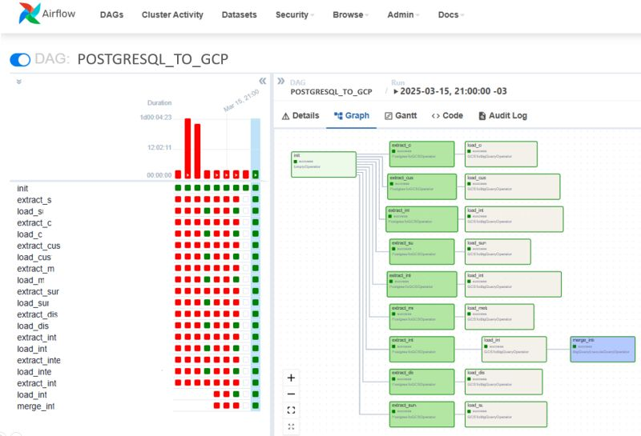

# Pipelines de dados — Python, Airflow e Google Cloud

Desenvolvi estes pipelines para extrair e organizar dados de pesquisas e experiência do cliente, conectando **MySQL, PostgreSQL, Google Cloud Storage e BigQuery**, com orquestração em **Apache Airflow**, SQL e notificações no **Slack e Microsoft Teams**.

O trabalho reuniu extrações por entidades, decisões de carga, transformação de metadados, tabelas temporárias e operações MERGE. O objetivo era disponibilizar dados para análise e dar visibilidade ao processamento, em vez de depender de exportações manuais isoladas.

## Evidência histórica

Capturei esta visualização durante o uso do ambiente, com a execução selecionada de 15/03/2025 e tarefas em verde. O histórico também mostra falhas anteriores. A imagem não comprova a execução de cada uma das DAGs desta publicação e não foi produzida em uma execução atual. Diagramas abaixo são reconstruídos a partir do código.

## Fluxos selecionados

| DAG pública | Técnicas e responsabilidades |
| --- | --- |
| [MySQL NPS: extração paralela e carga append](docs/dags/mysql_nps_parallel.md) | [Código Python](dags/mysql_nps_parallel.py) |
| [MySQL NPS: carga temporária, MERGE e Teams](docs/dags/mysql_nps_merge.md) | [Código Python](dags/mysql_nps_merge.py) |
| [PostgreSQL CXM: verificações, extrações, MERGE e Slack](docs/dags/postgres_cxm_pipeline.md) | [Código Python](dags/postgres_cxm_pipeline.py) |
| [PostgreSQL: pivot de metadados e MERGE](docs/dags/postgres_metadata_pivot.md) | [Código Python](dags/postgres_metadata_pivot.py) |
| [PostgreSQL: ramificações por disponibilidade de dados](docs/dags/postgres_metadata_branching.md) | [Código Python](dags/postgres_metadata_branching.py) |
| [PostgreSQL: respostas de interação e MERGE](docs/dags/postgres_interaction_answers.md) | [Código Python](dags/postgres_interaction_answers.py) |
| [MySQL: recorte histórico de respostas](docs/dags/mysql_questions_history.md) | [Código Python](dags/mysql_questions_history.py) |
| [GCS: carga manual de CSV no BigQuery](docs/dags/gcs_csv_manual_load.md) | [Código Python](dags/gcs_csv_manual_load.py) |
| [Monitoramento de tarefas externas e Slack](docs/dags/task_monitor_slack.md) | [Código Python](dags/task_monitor_slack.py) |

## Como explorar

- [Arquitetura e decisões de processamento](docs/arquitetura.md)
- [Seleção dos arquivos](docs/selecao.md)
- [Configuração e execução de testes](docs/configuracao.md)
- [Correções e limitações](docs/correcoes-limitacoes.md)
- [SQL selecionado](sql/)
- [Validação local](docs/validacao.md)

Cada página de DAG apresenta suas tarefas, parâmetros de carga e dependências. A numeração de consultas SQL é apenas de estudo e não define a ordem de execução: as dependências Python determinam essa ordem.

## Minha contribuição e aprendizado

Estruturei consultas e tarefas para transportar dados de bancos relacionais para o ambiente analítico, trabalhei diferentes formas de carga e transformação de metadados e implementei acompanhamento do processamento. Esse trabalho ampliou minha prática com Python, SQL, engenharia de dados, GCP e organização de pipelines.

## Escopo público

As cópias foram anonimizadas e adaptadas: empresas, identificadores e destinos privados foram substituídos. Os originais foram preservados. As DAGs estão pausadas na criação, sem agendamento e com notificações externas condicionadas a uma configuração explícita.

Não tenho mais acesso ao ambiente Airflow original. A validação desta publicação é local e estática, com testes específicos de lógica e estrutura; não houve execução dos pipelines em Airflow, bancos, GCS, BigQuery ou canais de mensagem. Não apresento benchmark ou garantia de operação em produção nesta versão.

As referências ao Airflow 2.10.4 são históricas. Consulte a configuração antes de preparar uma instalação isolada. Não foi concedida licença de reutilização nesta publicação.
