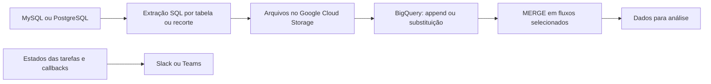

# Arquitetura dos pipelines

O Airflow orquestra dependências, tentativas, ramificações e notificações. GCS funciona como etapa de passagem de arquivos; BigQuery recebe os dados. O desenho agrega os padrões do repositório, não representa uma única DAG contendo todas essas etapas.

## Decisões visíveis no código

- Extrações independentes podem executar em paralelo no exemplo NPS básico.
- Outros fluxos encadeiam tabelas, cargas e MERGEs de forma sequencial.
- BranchPythonOperator consulta a origem para decidir entre extrair e seguir por um caminho sem carga.
- Metadados em linhas são projetados em colunas usando MAX(CASE...) e GROUP BY.
- Consultas, layouts de arquivos e schemas explícitos fazem a ponte entre a origem e o warehouse.
- O monitor usa ExternalTaskSensor e SlackNotifier; os callbacks dos pipelines são uma camada distinta do monitor central.

Use os inventários de cada DAG para verificar quais técnicas aparecem em cada arquivo. O repositório não contém agentes de IA ou LLMs.
