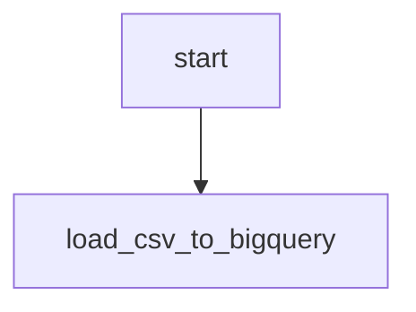

# GCS: carga manual de CSV no BigQuery

Desenvolvi este fluxo para organizar extração, transformação e disponibilização de dados. Esta é uma cópia pública adaptada do código histórico, sem acesso ao ambiente original.

- [DAG Python](../../dags/gcs_csv_manual_load.py)
- Agendamento original registrado no arquivo: None. O fuso depende da DAG/instância; não deduzi um horário local onde ele não é explícito.
- Publicação: agendamento desabilitado, DAG pausada na criação e notificações externas condicionadas a ENABLE_EXTERNAL_NOTIFICATIONS=true.
- 2 declarações de tarefas no código; fábricas e loops podem criar quantidades diferentes na importação do Airflow.
- 0 consultas SQL literais separadas para estudo; a execução usa a configuração no Python. As cópias SQL não são arquivos automaticamente carregados pela DAG.

## Processo e decisões

Este fluxo não consulta banco de origem: parte de um CSV já disponível no GCS e o carrega no BigQuery. A configuração informa separador ponto e vírgula, uma linha de cabeçalho, schema explícito e WRITE_TRUNCATE. O arquivo físico e os registros financeiros de origem não acompanham o exemplo. A substituição da tabela de destino deve ser uma decisão explícita ao adaptar.

## Tarefas

| Task ID | Operador | Parâmetros selecionados |
| --- | --- | --- |
| start | EmptyOperator | {} |
| load_csv_to_bigquery | GCSToBigQueryOperator | {"source_format": "'CSV'", "write_disposition": "'WRITE_TRUNCATE'"} |

## Dependências extraídas do código

O diagrama foi reconstruído estaticamente a partir das dependências Python, sem conexão com o Airflow. Para o monitor, a fábrica cria sensores dentro de um TaskGroup; consulte o código para a topologia dinâmica.

Consulte [limitações e correções](../correcoes-limitacoes.md) e [configuração](../configuracao.md) antes de adaptar este fluxo.
