# MySQL NPS: carga temporária, MERGE e Teams

Desenvolvi este fluxo para organizar extração, transformação e disponibilização de dados. Esta é uma cópia pública adaptada do código histórico, sem acesso ao ambiente original.

- [DAG Python](../../dags/mysql_nps_merge.py)
- Agendamento original registrado no arquivo: '0 1 * * *'. O fuso depende da DAG/instância; não deduzi um horário local onde ele não é explícito.
- Publicação: agendamento desabilitado, DAG pausada na criação e notificações externas condicionadas a ENABLE_EXTERNAL_NOTIFICATIONS=true.
- 32 declarações de tarefas no código; fábricas e loops podem criar quantidades diferentes na importação do Airflow.
- 18 consultas SQL literais separadas para estudo; a execução usa a configuração no Python. As cópias SQL não são arquivos automaticamente carregados pela DAG.

## Processo e decisões

O fluxo encadeia 12 extrações MySQL e respectivas cargas. Seis consultas de MERGE aparecem nas etapas de respostas, NPS e entidades de pós-venda. Entidades menores usam substituição; outras passam por tabelas temporárias antes da atualização dos destinos analíticos. O callback do finalizador produz a notificação Teams com status, datas e duração. O finalizador all_done não é uma garantia de sucesso integral da DAG.

## Tarefas

| Task ID | Operador | Parâmetros selecionados |
| --- | --- | --- |
| init | EmptyOperator | {} |
| campaign_mysql_to_gcs | MySQLToGCSOperator | {"export_format": "'json'"} |
| load_campain_data_to_bq | GCSToBigQueryOperator | {"source_format": "'NEWLINE_DELIMITED_JSON'", "write_disposition": "'WRITE_TRUNCATE'"} |
| organization_mysql_to_gcs | MySQLToGCSOperator | {"export_format": "'json'"} |
| load_organization_data_to_bq | GCSToBigQueryOperator | {"source_format": "'NEWLINE_DELIMITED_JSON'", "write_disposition": "'WRITE_TRUNCATE'"} |
| campaign_campaign_group_mysql_to_gcs | MySQLToGCSOperator | {"export_format": "'json'"} |
| load_campaign_campaign_group_to_bq | GCSToBigQueryOperator | {"source_format": "'NEWLINE_DELIMITED_JSON'", "write_disposition": "'WRITE_TRUNCATE'"} |
| campaign_group_mysql_to_gcs | MySQLToGCSOperator | {"export_format": "'json'"} |
| load_campaign_group_to_bq | GCSToBigQueryOperator | {"source_format": "'NEWLINE_DELIMITED_JSON'", "write_disposition": "'WRITE_TRUNCATE'"} |
| survey_mysql_to_gcs | MySQLToGCSOperator | {"export_format": "'json'"} |
| load_survey_to_bq | GCSToBigQueryOperator | {"source_format": "'NEWLINE_DELIMITED_JSON'", "write_disposition": "'WRITE_TRUNCATE'"} |
| question_mysql_to_gcs | MySQLToGCSOperator | {"export_format": "'json'"} |
| load_question_to_bq | GCSToBigQueryOperator | {"source_format": "'NEWLINE_DELIMITED_JSON'", "write_disposition": "'WRITE_TRUNCATE'"} |
| question_answer_mysql_to_gcs | MySQLToGCSOperator | {"export_format": "'json'"} |
| load_question_answer_to_bq_temp | GCSToBigQueryOperator | {"source_format": "'NEWLINE_DELIMITED_JSON'", "write_disposition": "'WRITE_TRUNCATE'"} |
| merge_question_answer | BigQueryInsertJobOperator | {} |
| question_answer_nps_mysql_to_gcs | MySQLToGCSOperator | {"export_format": "'json'"} |
| load_question_answer_nps_to_bq_temp | GCSToBigQueryOperator | {"source_format": "'NEWLINE_DELIMITED_JSON'", "write_disposition": "'WRITE_TRUNCATE'"} |
| merge_question_answer_nps | BigQueryInsertJobOperator | {} |
| post_sale_dispatch_mysql_to_gcs | MySQLToGCSOperator | {"export_format": "'json'"} |
| load_post_sale_dispatch_to_bq | GCSToBigQueryOperator | {"source_format": "'NEWLINE_DELIMITED_JSON'", "write_disposition": "'WRITE_TRUNCATE'"} |
| merge_post_sale_dispatch_nps | BigQueryInsertJobOperator | {} |
| post_sale_action_mysql_to_gcs | MySQLToGCSOperator | {"export_format": "'json'"} |
| load_post_sale_action_to_bq | GCSToBigQueryOperator | {"source_format": "'NEWLINE_DELIMITED_JSON'", "write_disposition": "'WRITE_TRUNCATE'"} |
| merge_post_sale_action_nps | BigQueryInsertJobOperator | {} |
| customers_mysql_to_gcs | MySQLToGCSOperator | {"export_format": "'json'"} |
| load_customer_to_bq | GCSToBigQueryOperator | {"source_format": "'NEWLINE_DELIMITED_JSON'", "write_disposition": "'WRITE_TRUNCATE'"} |
| merge_customer_nps | BigQueryInsertJobOperator | {} |
| schedule_mysql_to_gcs | MySQLToGCSOperator | {"export_format": "'json'"} |
| load_schedule_to_bq | GCSToBigQueryOperator | {"source_format": "'NEWLINE_DELIMITED_JSON'", "write_disposition": "'WRITE_TRUNCATE'"} |
| merge_schedule | BigQueryInsertJobOperator | {} |
| final_status | EmptyOperator | {"trigger_rule": "TriggerRule.ALL_DONE"} |

## Dependências extraídas do código

```mermaid
flowchart TD
    init["init"] --> campaign_mysql_to_gcs["campaign_mysql_to_gcs"]
    campaign_mysql_to_gcs["campaign_mysql_to_gcs"] --> load_campain_data_to_bq["load_campain_data_to_bq"]
    campaign_campaign_group_mysql_to_gcs["campaign_campaign_group_mysql_to_gcs"] --> load_campaign_campaign_group_to_bq["load_campaign_campaign_group_to_bq"]
    organization_mysql_to_gcs["organization_mysql_to_gcs"] --> load_organization_data_to_bq["load_organization_data_to_bq"]
    campaign_group_mysql_to_gcs["campaign_group_mysql_to_gcs"] --> load_campaign_group_to_bq["load_campaign_group_to_bq"]
    survey_mysql_to_gcs["survey_mysql_to_gcs"] --> load_survey_to_bq["load_survey_to_bq"]
    question_mysql_to_gcs["question_mysql_to_gcs"] --> load_question_to_bq["load_question_to_bq"]
    load_question_answer_to_bq_temp["load_question_answer_to_bq_temp"] --> merge_question_answer["merge_question_answer"]
    load_question_answer_nps_to_bq_temp["load_question_answer_nps_to_bq_temp"] --> merge_question_answer_nps["merge_question_answer_nps"]
    load_post_sale_dispatch_to_bq["load_post_sale_dispatch_to_bq"] --> merge_post_sale_dispatch_nps["merge_post_sale_dispatch_nps"]
    load_post_sale_action_to_bq["load_post_sale_action_to_bq"] --> merge_post_sale_action_nps["merge_post_sale_action_nps"]
    load_customer_to_bq["load_customer_to_bq"] --> merge_customer_nps["merge_customer_nps"]
    load_schedule_to_bq["load_schedule_to_bq"] --> merge_schedule["merge_schedule"]
    merge_schedule["merge_schedule"] --> final_status["final_status"]
    load_campain_data_to_bq["load_campain_data_to_bq"] --> campaign_campaign_group_mysql_to_gcs["campaign_campaign_group_mysql_to_gcs"]
    load_campaign_campaign_group_to_bq["load_campaign_campaign_group_to_bq"] --> organization_mysql_to_gcs["organization_mysql_to_gcs"]
    load_organization_data_to_bq["load_organization_data_to_bq"] --> campaign_group_mysql_to_gcs["campaign_group_mysql_to_gcs"]
    load_campaign_group_to_bq["load_campaign_group_to_bq"] --> survey_mysql_to_gcs["survey_mysql_to_gcs"]
    load_survey_to_bq["load_survey_to_bq"] --> question_mysql_to_gcs["question_mysql_to_gcs"]
    question_answer_mysql_to_gcs["question_answer_mysql_to_gcs"] --> load_question_answer_to_bq_temp["load_question_answer_to_bq_temp"]
    question_answer_nps_mysql_to_gcs["question_answer_nps_mysql_to_gcs"] --> load_question_answer_nps_to_bq_temp["load_question_answer_nps_to_bq_temp"]
    post_sale_dispatch_mysql_to_gcs["post_sale_dispatch_mysql_to_gcs"] --> load_post_sale_dispatch_to_bq["load_post_sale_dispatch_to_bq"]
    post_sale_action_mysql_to_gcs["post_sale_action_mysql_to_gcs"] --> load_post_sale_action_to_bq["load_post_sale_action_to_bq"]
    customers_mysql_to_gcs["customers_mysql_to_gcs"] --> load_customer_to_bq["load_customer_to_bq"]
    schedule_mysql_to_gcs["schedule_mysql_to_gcs"] --> load_schedule_to_bq["load_schedule_to_bq"]
    load_question_to_bq["load_question_to_bq"] --> question_answer_mysql_to_gcs["question_answer_mysql_to_gcs"]
    merge_question_answer["merge_question_answer"] --> question_answer_nps_mysql_to_gcs["question_answer_nps_mysql_to_gcs"]
    merge_question_answer_nps["merge_question_answer_nps"] --> post_sale_dispatch_mysql_to_gcs["post_sale_dispatch_mysql_to_gcs"]
    merge_post_sale_dispatch_nps["merge_post_sale_dispatch_nps"] --> post_sale_action_mysql_to_gcs["post_sale_action_mysql_to_gcs"]
    merge_post_sale_action_nps["merge_post_sale_action_nps"] --> customers_mysql_to_gcs["customers_mysql_to_gcs"]
    merge_customer_nps["merge_customer_nps"] --> schedule_mysql_to_gcs["schedule_mysql_to_gcs"]
```

O diagrama foi reconstruído estaticamente a partir das dependências Python, sem conexão com o Airflow. Para o monitor, a fábrica cria sensores dentro de um TaskGroup; consulte o código para a topologia dinâmica.

Consulte [limitações e correções](../correcoes-limitacoes.md) e [configuração](../configuracao.md) antes de adaptar este fluxo.
