# MySQL NPS: extração paralela e carga append

Desenvolvi este fluxo para organizar extração, transformação e disponibilização de dados. Esta é uma cópia pública adaptada do código histórico, sem acesso ao ambiente original.

- [DAG Python](../../dags/mysql_nps_parallel.py)
- Agendamento original registrado no arquivo: '@daily'. O fuso depende da DAG/instância; não deduzi um horário local onde ele não é explícito.
- Publicação: agendamento desabilitado, DAG pausada na criação e notificações externas condicionadas a ENABLE_EXTERNAL_NOTIFICATIONS=true.
- 16 declarações de tarefas no código; fábricas e loops podem criar quantidades diferentes na importação do Airflow.
- 7 consultas SQL literais separadas para estudo; a execução usa a configuração no Python. As cópias SQL não são arquivos automaticamente carregados pela DAG.

## Processo e decisões

A origem contém campanhas, grupos, pesquisas, perguntas e respostas NPS. Após init, sete pares de extração e carga podem executar em paralelo, convergindo em finish. A extração gera JSON no GCS e a carga usa WRITE_APPEND. Não há MERGE nem controle incremental por watermark neste exemplo; reexecuções precisam de tratamento para evitar duplicação.

## Tarefas

| Task ID | Operador | Parâmetros selecionados |
| --- | --- | --- |
| init | EmptyOperator | {} |
| campaign_mysql_to_gcs | MySQLToGCSOperator | {"export_format": "'json'"} |
| campaign_campaign_group_mysql_to_gcs | MySQLToGCSOperator | {"export_format": "'json'"} |
| campaign_group_mysql_to_gcs | MySQLToGCSOperator | {"export_format": "'json'"} |
| survey_mysql_to_gcs | MySQLToGCSOperator | {"export_format": "'json'"} |
| question_mysql_to_gcs | MySQLToGCSOperator | {"export_format": "'json'"} |
| question_answer_mysql_to_gcs | MySQLToGCSOperator | {"export_format": "'json'"} |
| question_answer_nps_mysql_to_gcs | MySQLToGCSOperator | {"export_format": "'json'"} |
| load_campain_data_to_bq | GCSToBigQueryOperator | {"source_format": "'NEWLINE_DELIMITED_JSON'", "write_disposition": "'WRITE_APPEND'"} |
| load_campaign_campaign_group_to_bq | GCSToBigQueryOperator | {"source_format": "'NEWLINE_DELIMITED_JSON'", "write_disposition": "'WRITE_APPEND'"} |
| load_campaign_group_to_bq | GCSToBigQueryOperator | {"source_format": "'NEWLINE_DELIMITED_JSON'", "write_disposition": "'WRITE_APPEND'"} |
| load_survey_to_bq | GCSToBigQueryOperator | {"source_format": "'NEWLINE_DELIMITED_JSON'", "write_disposition": "'WRITE_APPEND'"} |
| load_question_to_bq | GCSToBigQueryOperator | {"source_format": "'NEWLINE_DELIMITED_JSON'", "write_disposition": "'WRITE_APPEND'"} |
| load_question_answer_to_bq | GCSToBigQueryOperator | {"source_format": "'NEWLINE_DELIMITED_JSON'", "write_disposition": "'WRITE_APPEND'"} |
| load_question_answer_nps_to_bq | GCSToBigQueryOperator | {"source_format": "'NEWLINE_DELIMITED_JSON'", "write_disposition": "'WRITE_APPEND'"} |
| finish | EmptyOperator | {} |

## Dependências extraídas do código

```mermaid
flowchart TD
    init["init"] --> campaign_mysql_to_gcs["campaign_mysql_to_gcs"]
    init["init"] --> campaign_campaign_group_mysql_to_gcs["campaign_campaign_group_mysql_to_gcs"]
    init["init"] --> campaign_group_mysql_to_gcs["campaign_group_mysql_to_gcs"]
    init["init"] --> survey_mysql_to_gcs["survey_mysql_to_gcs"]
    init["init"] --> question_mysql_to_gcs["question_mysql_to_gcs"]
    init["init"] --> question_answer_mysql_to_gcs["question_answer_mysql_to_gcs"]
    init["init"] --> question_answer_nps_mysql_to_gcs["question_answer_nps_mysql_to_gcs"]
    campaign_mysql_to_gcs["campaign_mysql_to_gcs"] --> load_campain_data_to_bq["load_campain_data_to_bq"]
    campaign_campaign_group_mysql_to_gcs["campaign_campaign_group_mysql_to_gcs"] --> load_campaign_campaign_group_to_bq["load_campaign_campaign_group_to_bq"]
    campaign_group_mysql_to_gcs["campaign_group_mysql_to_gcs"] --> load_campaign_group_to_bq["load_campaign_group_to_bq"]
    survey_mysql_to_gcs["survey_mysql_to_gcs"] --> load_survey_to_bq["load_survey_to_bq"]
    question_mysql_to_gcs["question_mysql_to_gcs"] --> load_question_to_bq["load_question_to_bq"]
    question_answer_mysql_to_gcs["question_answer_mysql_to_gcs"] --> load_question_answer_to_bq["load_question_answer_to_bq"]
    question_answer_nps_mysql_to_gcs["question_answer_nps_mysql_to_gcs"] --> load_question_answer_nps_to_bq["load_question_answer_nps_to_bq"]
    load_campain_data_to_bq["load_campain_data_to_bq"] --> finish["finish"]
    load_campaign_campaign_group_to_bq["load_campaign_campaign_group_to_bq"] --> finish["finish"]
    load_campaign_group_to_bq["load_campaign_group_to_bq"] --> finish["finish"]
    load_survey_to_bq["load_survey_to_bq"] --> finish["finish"]
    load_question_to_bq["load_question_to_bq"] --> finish["finish"]
    load_question_answer_to_bq["load_question_answer_to_bq"] --> finish["finish"]
    load_question_answer_nps_to_bq["load_question_answer_nps_to_bq"] --> finish["finish"]
```

O diagrama foi reconstruído estaticamente a partir das dependências Python, sem conexão com o Airflow. Para o monitor, a fábrica cria sensores dentro de um TaskGroup; consulte o código para a topologia dinâmica.

Consulte [limitações e correções](../correcoes-limitacoes.md) e [configuração](../configuracao.md) antes de adaptar este fluxo.
