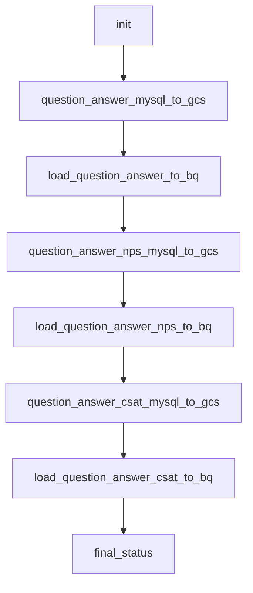

# MySQL: recorte histórico de respostas

Desenvolvi este fluxo para organizar extração, transformação e disponibilização de dados. Esta é uma cópia pública adaptada do código histórico, sem acesso ao ambiente original.

- [DAG Python](../../dags/mysql_questions_history.py)
- Agendamento original registrado no arquivo: '@daily'. O fuso depende da DAG/instância; não deduzi um horário local onde ele não é explícito.
- Publicação: agendamento desabilitado, DAG pausada na criação e notificações externas condicionadas a ENABLE_EXTERNAL_NOTIFICATIONS=true.
- 8 declarações de tarefas no código; fábricas e loops podem criar quantidades diferentes na importação do Airflow.
- 3 consultas SQL literais separadas para estudo; a execução usa a configuração no Python. As cópias SQL não são arquivos automaticamente carregados pela DAG.

## Processo e decisões

O código separa respostas comuns, NPS e CSAT, com recortes fixos de datas e cargas APPEND. O arquivo histórico usa um período de 2021 para dois conjuntos e de 2025 para outro; preservei essa diferença e não o apresento como um processamento uniforme de um ano inteiro. Antes de reutilizar, ajuste explicitamente os períodos e a política de reexecução. O finalizador contém a notificação Slack.

## Tarefas

| Task ID | Operador | Parâmetros selecionados |
| --- | --- | --- |
| init | EmptyOperator | {} |
| question_answer_mysql_to_gcs | MySQLToGCSOperator | {"export_format": "'json'"} |
| load_question_answer_to_bq | GCSToBigQueryOperator | {"source_format": "'NEWLINE_DELIMITED_JSON'", "write_disposition": "'WRITE_APPEND'"} |
| question_answer_nps_mysql_to_gcs | MySQLToGCSOperator | {"export_format": "'json'"} |
| load_question_answer_nps_to_bq | GCSToBigQueryOperator | {"source_format": "'NEWLINE_DELIMITED_JSON'", "write_disposition": "'WRITE_APPEND'"} |
| question_answer_csat_mysql_to_gcs | MySQLToGCSOperator | {"export_format": "'json'"} |
| load_question_answer_csat_to_bq | GCSToBigQueryOperator | {"source_format": "'NEWLINE_DELIMITED_JSON'", "write_disposition": "'WRITE_APPEND'"} |
| final_status | EmptyOperator | {"trigger_rule": "TriggerRule.ALL_DONE"} |

## Dependências extraídas do código

O diagrama foi reconstruído estaticamente a partir das dependências Python, sem conexão com o Airflow. Para o monitor, a fábrica cria sensores dentro de um TaskGroup; consulte o código para a topologia dinâmica.

Consulte [limitações e correções](../correcoes-limitacoes.md) e [configuração](../configuracao.md) antes de adaptar este fluxo.
