# PostgreSQL CXM: verificações, extrações, MERGE e Slack

Desenvolvi este fluxo para organizar extração, transformação e disponibilização de dados. Esta é uma cópia pública adaptada do código histórico, sem acesso ao ambiente original.

- [DAG Python](../../dags/postgres_cxm_pipeline.py)
- Agendamento original registrado no arquivo: '0 1 * * *'. O fuso depende da DAG/instância; não deduzi um horário local onde ele não é explícito.
- Publicação: agendamento desabilitado, DAG pausada na criação e notificações externas condicionadas a ENABLE_EXTERNAL_NOTIFICATIONS=true.
- 55 declarações de tarefas no código; fábricas e loops podem criar quantidades diferentes na importação do Airflow.
- 25 consultas SQL literais separadas para estudo; a execução usa a configuração no Python. As cópias SQL não são arquivos automaticamente carregados pela DAG.

## Processo e decisões

Este é o exemplo mais amplo da seleção: contém nove verificações de disponibilidade e nove pares PostgreSQL → GCS → BigQuery, além de consultas de consolidação. O pipeline trabalha pesquisas, itens, clientes, metadados, distribuições e interações. As decisões consultam a origem antes de escolher o caminho de extração ou o caminho sem carga. O callback Slack resume a execução; as regras all_done e a política de falha histórica estão descritas nas limitações.

## Tarefas

| Task ID | Operador | Parâmetros selecionados |
| --- | --- | --- |
| init | EmptyOperator | {} |
| check_data_surveys | BranchPythonOperator | {} |
| pause_task_surveys | EmptyOperator | {"trigger_rule": "'all_done'"} |
| extract_surveys | PostgresToGCSOperator | {"export_format": "'json'"} |
| load_surveys_to_bigquery | GCSToBigQueryOperator | {"source_format": "'NEWLINE_DELIMITED_JSON'", "write_disposition": "'WRITE_TRUNCATE'"} |
| continue_after_surveys | DummyOperator | {"trigger_rule": "'all_done'"} |
| check_data_metadata | BranchPythonOperator | {} |
| pause_task_metadata | DummyOperator | {} |
| extract_metadata | PostgresToGCSOperator | {"export_format": "'json'"} |
| load_metadata_to_bigquery | GCSToBigQueryOperator | {"source_format": "'NEWLINE_DELIMITED_JSON'", "write_disposition": "'WRITE_TRUNCATE'"} |
| continue_after_metadata | DummyOperator | {"trigger_rule": "'all_done'"} |
| check_data_surveys_items | BranchPythonOperator | {} |
| pause_task_surveys_items | DummyOperator | {} |
| extract_surveys_items | PostgresToGCSOperator | {"export_format": "'json'"} |
| load_surveys_items_to_bigquery | GCSToBigQueryOperator | {"source_format": "'NEWLINE_DELIMITED_JSON'", "write_disposition": "'WRITE_TRUNCATE'"} |
| continue_after_surveys_items | DummyOperator | {"trigger_rule": "'all_done'"} |
| check_data_customers | BranchPythonOperator | {} |
| pause_task_customers | DummyOperator | {} |
| extract_customers | PostgresToGCSOperator | {"export_format": "'json'"} |
| load_customers_to_bigquery | GCSToBigQueryOperator | {"source_format": "'NEWLINE_DELIMITED_JSON'", "write_disposition": "'WRITE_APPEND'"} |
| merge_customer | BigQueryInsertJobOperator | {} |
| continue_after_customers | DummyOperator | {"trigger_rule": "'all_done'"} |
| check_data_customer_metadata | BranchPythonOperator | {} |
| pause_task_customer_metadata | DummyOperator | {} |
| extract_customer_metadata | PostgresToGCSOperator | {"export_format": "'json'"} |
| load_customer_metadata_to_bigquery | GCSToBigQueryOperator | {"source_format": "'NEWLINE_DELIMITED_JSON'", "write_disposition": "'WRITE_TRUNCATE'"} |
| merge_customer_metadata | BigQueryInsertJobOperator | {} |
| continue_after_customer_metadata | DummyOperator | {"trigger_rule": "'all_done'"} |
| check_data_distributions | BranchPythonOperator | {} |
| pause_task_distributions | DummyOperator | {} |
| extract_distributions | PostgresToGCSOperator | {"export_format": "'json'"} |
| load_distributions_to_bigquery | GCSToBigQueryOperator | {"source_format": "'NEWLINE_DELIMITED_JSON'", "write_disposition": "'WRITE_APPEND'"} |
| continue_after_distributions | DummyOperator | {"trigger_rule": "'all_done'"} |
| check_data_interaction_metadata | BranchPythonOperator | {} |
| pause_task_interaction_metadata | DummyOperator | {} |
| extract_interaction_metadata | PostgresToGCSOperator | {"export_format": "'json'"} |
| load_interaction_metadata_temp | GCSToBigQueryOperator | {"source_format": "'NEWLINE_DELIMITED_JSON'", "write_disposition": "'WRITE_TRUNCATE'"} |
| merge_interaction_metadata | BigQueryInsertJobOperator | {} |
| continue_after_interaction_metadata | DummyOperator | {"trigger_rule": "'all_done'"} |
| check_data_interaction_answers | BranchPythonOperator | {} |
| pause_task_interaction_answers | DummyOperator | {} |
| extract_interaction_answers | PostgresToGCSOperator | {"export_format": "'json'"} |
| load_interaction_answers_temp | GCSToBigQueryOperator | {"source_format": "'NEWLINE_DELIMITED_JSON'", "write_disposition": "'WRITE_TRUNCATE'"} |
| merge_interactions_answers | BigQueryInsertJobOperator | {} |
| continue_after_interaction_answers | DummyOperator | {"trigger_rule": "'all_done'"} |
| check_data_interactions | BranchPythonOperator | {} |
| pause_task_interactions | DummyOperator | {} |
| extract_interactions | PostgresToGCSOperator | {"export_format": "'json'"} |
| load_interactions_temp | GCSToBigQueryOperator | {"source_format": "'NEWLINE_DELIMITED_JSON'", "write_disposition": "'WRITE_TRUNCATE'"} |
| merge_interactions | BigQueryInsertJobOperator | {} |
| continue_after_interactions | DummyOperator | {"trigger_rule": "'all_done'"} |
| creat_metadata_pivot | BigQueryInsertJobOperator | {} |
| continue_after_metadata_pivot | DummyOperator | {"trigger_rule": "'all_done'"} |
| create_customer_metadata_pivot | BigQueryInsertJobOperator | {} |
| final_status | EmptyOperator | {"trigger_rule": "TriggerRule.ALL_DONE"} |

## Dependências extraídas do código

```mermaid
flowchart TD
    init["init"] --> check_data_surveys["check_data_surveys"]
    check_data_surveys["check_data_surveys"] --> pause_task_surveys["pause_task_surveys"]
    check_data_surveys["check_data_surveys"] --> extract_surveys["extract_surveys"]
    extract_surveys["extract_surveys"] --> load_surveys_to_bigquery["load_surveys_to_bigquery"]
    load_surveys_to_bigquery["load_surveys_to_bigquery"] --> continue_after_surveys["continue_after_surveys"]
    pause_task_surveys["pause_task_surveys"] --> continue_after_surveys["continue_after_surveys"]
    continue_after_surveys["continue_after_surveys"] --> check_data_customer_metadata["check_data_customer_metadata"]
    check_data_customer_metadata["check_data_customer_metadata"] --> pause_task_customer_metadata["pause_task_customer_metadata"]
    check_data_customer_metadata["check_data_customer_metadata"] --> extract_customer_metadata["extract_customer_metadata"]
    merge_customer_metadata["merge_customer_metadata"] --> continue_after_customer_metadata["continue_after_customer_metadata"]
    pause_task_customer_metadata["pause_task_customer_metadata"] --> continue_after_customer_metadata["continue_after_customer_metadata"]
    continue_after_customer_metadata["continue_after_customer_metadata"] --> check_data_customers["check_data_customers"]
    check_data_customers["check_data_customers"] --> pause_task_customers["pause_task_customers"]
    check_data_customers["check_data_customers"] --> extract_customers["extract_customers"]
    merge_customer["merge_customer"] --> continue_after_customers["continue_after_customers"]
    pause_task_customers["pause_task_customers"] --> continue_after_customers["continue_after_customers"]
    continue_after_customers["continue_after_customers"] --> check_data_metadata["check_data_metadata"]
    check_data_metadata["check_data_metadata"] --> pause_task_metadata["pause_task_metadata"]
    check_data_metadata["check_data_metadata"] --> extract_metadata["extract_metadata"]
    extract_metadata["extract_metadata"] --> load_metadata_to_bigquery["load_metadata_to_bigquery"]
    load_metadata_to_bigquery["load_metadata_to_bigquery"] --> continue_after_metadata["continue_after_metadata"]
    pause_task_metadata["pause_task_metadata"] --> continue_after_metadata["continue_after_metadata"]
    continue_after_metadata["continue_after_metadata"] --> check_data_surveys_items["check_data_surveys_items"]
    check_data_surveys_items["check_data_surveys_items"] --> pause_task_surveys_items["pause_task_surveys_items"]
    check_data_surveys_items["check_data_surveys_items"] --> extract_surveys_items["extract_surveys_items"]
    extract_surveys_items["extract_surveys_items"] --> load_surveys_items_to_bigquery["load_surveys_items_to_bigquery"]
    load_surveys_items_to_bigquery["load_surveys_items_to_bigquery"] --> continue_after_surveys_items["continue_after_surveys_items"]
    pause_task_surveys_items["pause_task_surveys_items"] --> continue_after_surveys_items["continue_after_surveys_items"]
    continue_after_surveys_items["continue_after_surveys_items"] --> check_data_distributions["check_data_distributions"]
    check_data_distributions["check_data_distributions"] --> pause_task_distributions["pause_task_distributions"]
    check_data_distributions["check_data_distributions"] --> extract_distributions["extract_distributions"]
    extract_distributions["extract_distributions"] --> load_distributions_to_bigquery["load_distributions_to_bigquery"]
    load_distributions_to_bigquery["load_distributions_to_bigquery"] --> continue_after_distributions["continue_after_distributions"]
    pause_task_distributions["pause_task_distributions"] --> continue_after_distributions["continue_after_distributions"]
    continue_after_distributions["continue_after_distributions"] --> check_data_interaction_metadata["check_data_interaction_metadata"]
    check_data_interaction_metadata["check_data_interaction_metadata"] --> pause_task_interaction_metadata["pause_task_interaction_metadata"]
    check_data_interaction_metadata["check_data_interaction_metadata"] --> extract_interaction_metadata["extract_interaction_metadata"]
    merge_interaction_metadata["merge_interaction_metadata"] --> continue_after_interaction_metadata["continue_after_interaction_metadata"]
    pause_task_interaction_metadata["pause_task_interaction_metadata"] --> continue_after_interaction_metadata["continue_after_interaction_metadata"]
    continue_after_interaction_metadata["continue_after_interaction_metadata"] --> check_data_interaction_answers["check_data_interaction_answers"]
    check_data_interaction_answers["check_data_interaction_answers"] --> pause_task_interaction_answers["pause_task_interaction_answers"]
    check_data_interaction_answers["check_data_interaction_answers"] --> extract_interaction_answers["extract_interaction_answers"]
    merge_interactions_answers["merge_interactions_answers"] --> continue_after_interaction_answers["continue_after_interaction_answers"]
    pause_task_interaction_answers["pause_task_interaction_answers"] --> continue_after_interaction_answers["continue_after_interaction_answers"]
    continue_after_interaction_answers["continue_after_interaction_answers"] --> check_data_interactions["check_data_interactions"]
    check_data_interactions["check_data_interactions"] --> pause_task_interactions["pause_task_interactions"]
    check_data_interactions["check_data_interactions"] --> extract_interactions["extract_interactions"]
    merge_interactions["merge_interactions"] --> continue_after_interactions["continue_after_interactions"]
    pause_task_interactions["pause_task_interactions"] --> continue_after_interactions["continue_after_interactions"]
    creat_metadata_pivot["creat_metadata_pivot"] --> continue_after_metadata_pivot["continue_after_metadata_pivot"]
    create_customer_metadata_pivot["create_customer_metadata_pivot"] --> final_status["final_status"]
    load_customer_metadata_to_bigquery["load_customer_metadata_to_bigquery"] --> merge_customer_metadata["merge_customer_metadata"]
    load_customers_to_bigquery["load_customers_to_bigquery"] --> merge_customer["merge_customer"]
    load_interaction_metadata_temp["load_interaction_metadata_temp"] --> merge_interaction_metadata["merge_interaction_metadata"]
    load_interaction_answers_temp["load_interaction_answers_temp"] --> merge_interactions_answers["merge_interactions_answers"]
    load_interactions_temp["load_interactions_temp"] --> merge_interactions["merge_interactions"]
    continue_after_interactions["continue_after_interactions"] --> creat_metadata_pivot["creat_metadata_pivot"]
    continue_after_metadata_pivot["continue_after_metadata_pivot"] --> create_customer_metadata_pivot["create_customer_metadata_pivot"]
    extract_customer_metadata["extract_customer_metadata"] --> load_customer_metadata_to_bigquery["load_customer_metadata_to_bigquery"]
    extract_customers["extract_customers"] --> load_customers_to_bigquery["load_customers_to_bigquery"]
    extract_interaction_metadata["extract_interaction_metadata"] --> load_interaction_metadata_temp["load_interaction_metadata_temp"]
    extract_interaction_answers["extract_interaction_answers"] --> load_interaction_answers_temp["load_interaction_answers_temp"]
    extract_interactions["extract_interactions"] --> load_interactions_temp["load_interactions_temp"]
```

O diagrama foi reconstruído estaticamente a partir das dependências Python, sem conexão com o Airflow. Para o monitor, a fábrica cria sensores dentro de um TaskGroup; consulte o código para a topologia dinâmica.

Consulte [limitações e correções](../correcoes-limitacoes.md) e [configuração](../configuracao.md) antes de adaptar este fluxo.
