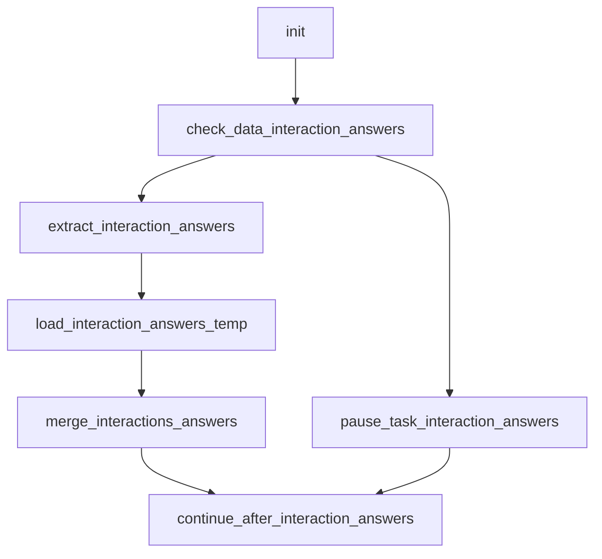

# PostgreSQL: respostas de interação e MERGE

Desenvolvi este fluxo para organizar extração, transformação e disponibilização de dados. Esta é uma cópia pública adaptada do código histórico, sem acesso ao ambiente original.

- [DAG Python](../../dags/postgres_interaction_answers.py)
- Agendamento original registrado no arquivo: '0 4 * * *'. O fuso depende da DAG/instância; não deduzi um horário local onde ele não é explícito.
- Publicação: agendamento desabilitado, DAG pausada na criação e notificações externas condicionadas a ENABLE_EXTERNAL_NOTIFICATIONS=true.
- 7 declarações de tarefas no código; fábricas e loops podem criar quantidades diferentes na importação do Airflow.
- 3 consultas SQL literais separadas para estudo; a execução usa a configuração no Python. As cópias SQL não são arquivos automaticamente carregados pela DAG.

## Processo e decisões

O branch verifica dados antes da extração de respostas de interação. Os registros passam pelo GCS e por uma tabela temporária no BigQuery antes do MERGE. O arquivo permite estudar a combinação de condição de execução, schema de carga e atualização de um destino, sem precisar publicar um pipeline amplo inteiro.

## Tarefas

| Task ID | Operador | Parâmetros selecionados |
| --- | --- | --- |
| init | EmptyOperator | {} |
| check_data_interaction_answers | BranchPythonOperator | {} |
| pause_task_interaction_answers | DummyOperator | {} |
| extract_interaction_answers | PostgresToGCSOperator | {"export_format": "'json'"} |
| load_interaction_answers_temp | GCSToBigQueryOperator | {"source_format": "'NEWLINE_DELIMITED_JSON'", "write_disposition": "'WRITE_TRUNCATE'"} |
| merge_interactions_answers | BigQueryInsertJobOperator | {} |
| continue_after_interaction_answers | DummyOperator | {"trigger_rule": "'all_done'"} |

## Dependências extraídas do código

O diagrama foi reconstruído estaticamente a partir das dependências Python, sem conexão com o Airflow. Para o monitor, a fábrica cria sensores dentro de um TaskGroup; consulte o código para a topologia dinâmica.

Consulte [limitações e correções](../correcoes-limitacoes.md) e [configuração](../configuracao.md) antes de adaptar este fluxo.
