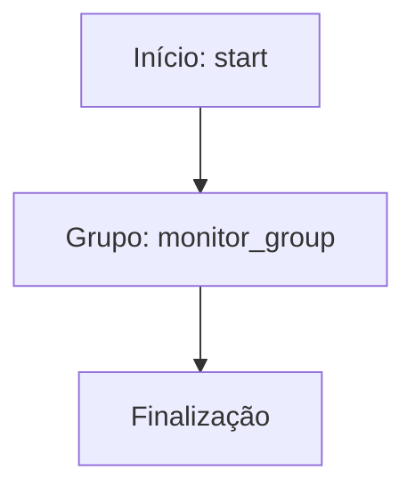
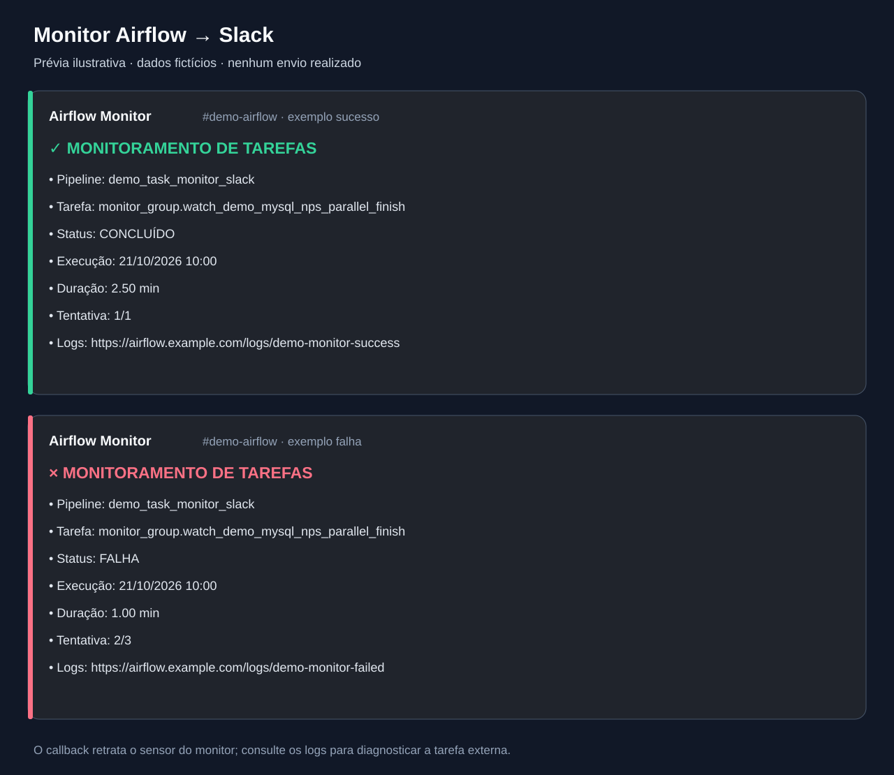

# Monitoramento de tarefas externas e Slack

Desenvolvi este fluxo para acompanhar tarefas de outras DAGs e avisar a equipe pelo Slack quando o sensor conclui ou falha. Esta é uma cópia pública adaptada do código histórico, sem acesso ao ambiente original.

- [DAG Python](../../dags/task_monitor_slack.py)
- Agendamento original registrado no arquivo: '*/10 * * * *'. O fuso depende da DAG/instância; não deduzi um horário local onde ele não é explícito.
- Publicação: agendamento desabilitado, DAG pausada na criação e notificações externas condicionadas a ENABLE_EXTERNAL_NOTIFICATIONS=true.
- 3 declarações de tarefas no código; fábricas e loops podem criar quantidades diferentes na importação do Airflow.
- 0 consultas SQL literais separadas para estudo; a execução usa a configuração no Python. As cópias SQL não são arquivos automaticamente carregados pela DAG.

## Processo e decisões

O monitor cria sensores para tarefas externas e notifica pelo Slack. Na cópia pública, TASKS_TO_MONITOR aponta para uma tarefa demonstrativa do repositório, falha externa pertence a failed_states e os sensores são criados no contexto do TaskGroup. O execution_delta histórico de dez minutos foi preservado como configuração a revisar: não equivale a buscar automaticamente a execução mais recente. Nenhum sensor foi executado nesta preparação.

## Tarefas

| Task ID | Operador | Parâmetros selecionados |
| --- | --- | --- |
| start | EmptyOperator | {} |
| end | EmptyOperator | {} |
| `watch_{dag_id}_{task_id}` | ExternalTaskSensor | {} |

## Dependências extraídas do código

O diagrama foi reconstruído estaticamente a partir das dependências Python, sem conexão com o Airflow. Para o monitor, a fábrica cria sensores dentro de um TaskGroup; consulte o código para a topologia dinâmica.

## Como fica a mensagem no Slack

**Prévia ilustrativa, com dados fictícios. Não é uma captura de uma execução real do Slack.** Produzi os textos executando somente a função `slack_notification_callback` isolada, com um contexto de tarefa demonstrativo e um `SlackNotifier` falso que captura o conteúdo sem enviar mensagens.

### Exemplo de sucesso

> ✅ **MONITORAMENTO DE TAREFAS** ✅  
> • **Pipeline:** `demo_task_monitor_slack`  
> • **Tarefa:** `monitor_group.watch_demo_mysql_nps_parallel_finish`  
> • **Status:** CONCLUÍDO  
> • **Execução:** 21/10/2026 10:00  
> • **Duração:** 2.50 min  
> • **Tentativa:** 1/1  
> • **Logs:** https://airflow.example.com/logs/demo-monitor-success

### Exemplo de falha

> ❌ **MONITORAMENTO DE TAREFAS** ❌  
> • **Pipeline:** `demo_task_monitor_slack`  
> • **Tarefa:** `monitor_group.watch_demo_mysql_nps_parallel_finish`  
> • **Status:** FALHA  
> • **Execução:** 21/10/2026 10:00  
> • **Duração:** 1.00 min  
> • **Tentativa:** 2/3  
> • **Logs:** https://airflow.example.com/logs/demo-monitor-failed

O endereço é fictício. A aparência e os emojis podem variar conforme o cliente Slack; a prévia em SVG ilustra o conteúdo e não promete uma reprodução exata da interface.

### De onde vem cada campo

| Campo | Origem na função Python |
| --- | --- |
| Pipeline | `ti.dag_id`: DAG da tarefa cujo callback foi chamado |
| Tarefa | `ti.task_id`: neste exemplo, o sensor dentro do grupo |
| Status | Comparação de `ti.state` com `State.SUCCESS` |
| Execução | `ti.execution_date`, formatado como dia/mês/ano e hora |
| Duração | Diferença entre `end_date` e `start_date`, em minutos |
| Tentativa | `try_number` e `max_tries + 1`, conforme o contexto recebido |
| Logs | `ti.log_url` |

**Execução é a data lógica fornecida pelo Airflow, não necessariamente a hora do envio ao Slack.** O fuso não é convertido nessa função. Na cópia atual, datas de início/fim ausentes resultam em duração 0.00, o que não comprova execução instantânea.

### O que a mensagem de falha informa

O corpo atual indica **FALHA**, tarefa, duração, tentativa e acesso aos logs. **Não contém a exceção nem o stack trace.** A falha do sensor pode ocorrer por falha externa ou por timeout; o texto sozinho não distingue essas causas.

Como o callback usa a instância do sensor, o campo Pipeline mostra a DAG do monitor e o campo Tarefa mostra o sensor. A tarefa externa está configurada em `TASKS_TO_MONITOR`; não substituí silenciosamente esses campos por dados da execução externa.

O código também define callbacks em `default_args`, por isso outros nós podem produzir mensagens. Os exemplos acima representam especificamente o sensor, não uma garantia de um único alerta por execução.

### Arquivos dos exemplos

- [Payloads de texto capturados em JSON](../../examples/slack/mensagens.json)
- [Mensagem de sucesso no formato Slack](../../examples/slack/success.txt)
- [Mensagem de falha no formato Slack](../../examples/slack/failed.txt)

### Sobre a correção do diagrama

O identificador `end` do Mermaid foi trocado por `FINISH_NODE`. O nome da tarefa Python continua sendo `end`: esse nome é válido no Airflow. A restrição pertence à [sintaxe de fluxogramas do Mermaid](https://mermaid.js.org/syntax/flowchart.html), não ao processamento da DAG.

Consulte [limitações e correções](../correcoes-limitacoes.md) e [configuração](../configuracao.md) antes de adaptar este fluxo.
